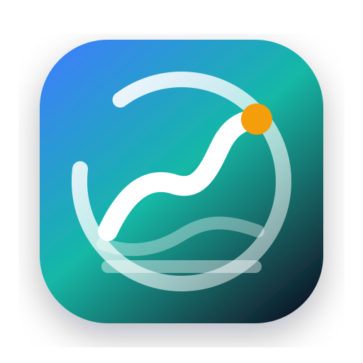
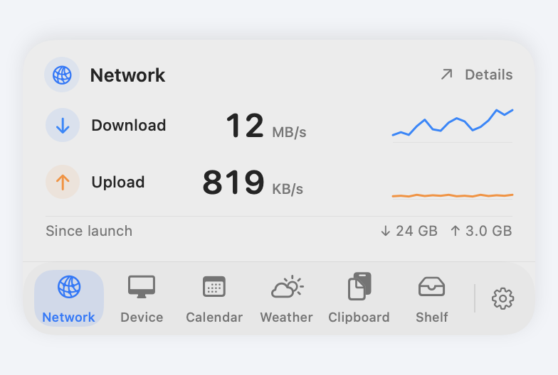
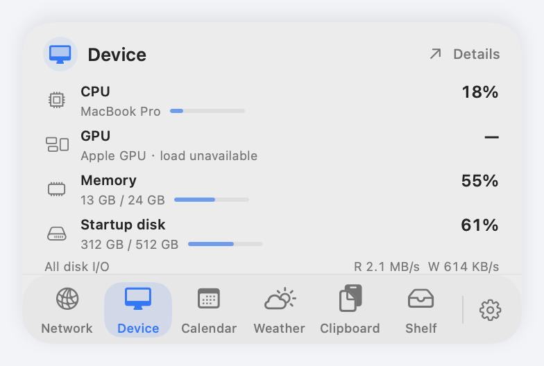

<p align="center">
  
</p>

<h1 align="center">NetStats</h1>

<p align="center">System monitoring and everyday tools in your Mac’s menu bar</p>

<p align="center">
  <a href="README.md">简体中文</a> · <strong>English</strong>
</p>

<p align="center">
  <a href="https://github.com/autumncry/netstats/releases/latest"></a>
  
  <a href="LICENSE"></a>
</p>

<p align="center">
  <a href="https://github.com/autumncry/netstats/releases/download/v2.01/NetStats-2.0.1.dmg"><strong>Download v2.01</strong></a> ·
  <a href="https://github.com/autumncry/netstats/releases/tag/v2.01">Release notes</a> ·
  <a href="https://autumncry.github.io/netstats/">Website</a>
</p>

<p align="center">
  
  
  <br>
  <sub>v2.01 native view renders · Example data · Reduce Transparency enabled. <a href="assets/screenshots/v2.01/README.md">About these images</a></sub>
</p>

Check network and device activity, glance at your calendar and weather, find something you copied, or keep files within reach. Open the card from the menu bar, or hover over the built-in notch on a supported MacBook.

## Installation

**[Download NetStats-2.0.1.dmg](https://github.com/autumncry/netstats/releases/download/v2.01/NetStats-2.0.1.dmg)** · macOS 14+ · Apple Silicon / Intel

When upgrading, quit the old version first. Replacing the app preserves existing settings and local history.

1. Open the DMG and drag **NetStats.app** into **Applications**.
2. Launch NetStats from Applications, then click its menu-bar item.

> The app is ad-hoc signed and not notarized by Apple. If macOS blocks the first launch, confirm you downloaded it from this repository, then allow it in **System Settings → Privacy & Security**. [Checksum](https://github.com/autumncry/netstats/releases/download/v2.01/NetStats-2.0.1.dmg.sha256)

## One card, six uses

### See what your Mac is doing

- **Network** — live download and upload rates, paired trends and traffic totals since launch.
- **Device** — CPU, GPU, memory and storage at a glance. Open **Details** for the full monitor.

### Keep your day in view

- **Calendar** — browse by month or week and check events for a selected day. Create and edit events in the system Calendar app.
- **Weather** — connect Apple Weather through a system shortcut for your chosen city’s current temperature and conditions. [Setup guide](docs/weather-shortcut.md)

### Keep useful things close

- **Clipboard** — searchable text and image history with preview, copy, pause and clear controls.
- **Shelf** — drop in files or folders, then drag them into another app. Only references are stored; originals are never moved or deleted.

## Make it yours

Switch features with the navigation bar at the bottom of the card. The gear opens a **standalone Settings window**, with individual feature switches shared by both entrances.

- **Menu bar:** click to open, click again to close. No notch required.
- **Notch hover:** enable it in Settings, hover for one second to open, then move away to dismiss.
- **Full monitor:** choose **Details** for Native / Terminal views with additional system metrics, process rankings and Clash Verge Dev status.

Network, Device and Shelf start enabled. Enable Calendar, Weather, Clipboard and notch hover in Settings. The app supports Simplified Chinese, English, and the system’s light and dark appearances. [User guide](docs/notch-hover.md)

## FAQ

<details>
<summary><strong>Why is Weather empty?</strong></summary>

Enable Weather, create a system shortcut named `NetStats Weather`, then test its connection in NetStats. Installing the app does not create the shortcut. Follow the [illustrated setup guide](docs/weather-shortcut.md) (Chinese). The card shows current conditions, not a forecast.

</details>

<details>
<summary><strong>Why does GPU load show “—”?</strong></summary>

Some devices or drivers do not expose a usable reading. NetStats marks it unavailable instead of showing 0%.

</details>

<details>
<summary><strong>Can I install it with Homebrew or npm?</strong></summary>

Use the DMG above for now. The separate Homebrew tap has not been updated to v2.01, and the npm package has not been published.

</details>

## Privacy and permissions

No account or telemetry. System metrics, clipboard history and file references are processed locally. Clipboard history has no additional app-level encryption; you can pause or clear it at any time.

Calendar requires an explicit grant; clipboard collection requires permission on macOS versions with clipboard access controls. Weather shortcuts may contact Apple services. Optional public-IP lookup uses `ipinfo.io` and can be disabled in Settings. NetStats only displays Clash Verge Dev status; it does not control or restart it. [Privacy](docs/PRIVACY.md) · [Permissions](docs/PERMISSIONS.md)

## Build from source

Requires Swift 6 and a toolchain with the macOS 26 SDK or later.

```bash
git clone https://github.com/autumncry/netstats.git
cd netstats
NETSTATS_BUILD_CONFIGURATION=release ./script/build_and_run.sh
```

Run checks with `swift test` and `swift run NetStatsLogicTests`. See the [development guide](CONTRIBUTING.md) for more build and packaging options.

## Feedback and contributing

[Report a bug or suggest an improvement](https://github.com/autumncry/netstats/issues). Include your app version, macOS version, Mac model and steps to reproduce. Screenshots help with UI issues; hide private information before sharing.

[Contributing](CONTRIBUTING.md) · [Changelog](CHANGELOG.md) · [Security](SECURITY.md)

## License

[MIT](LICENSE)
