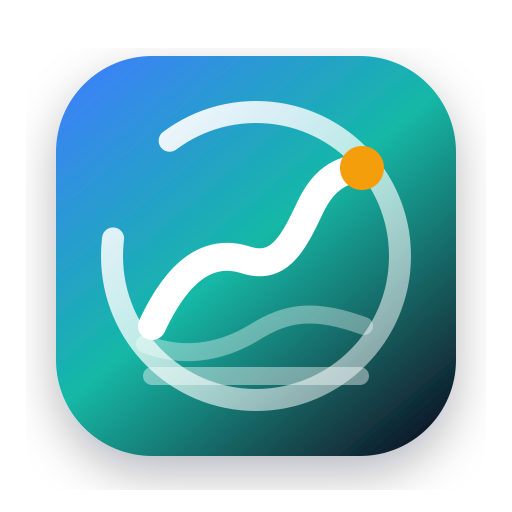
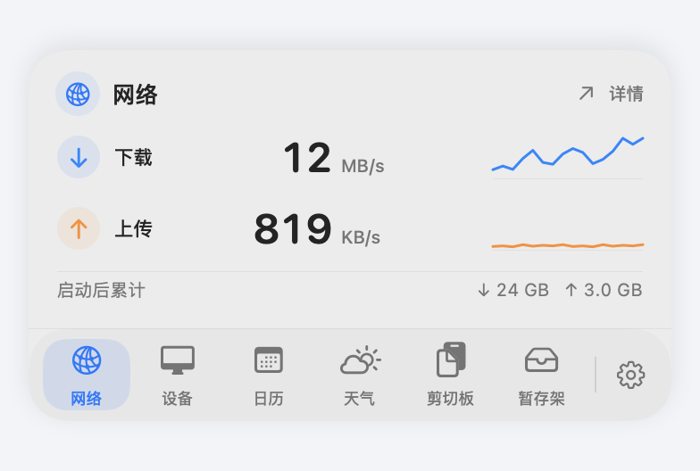
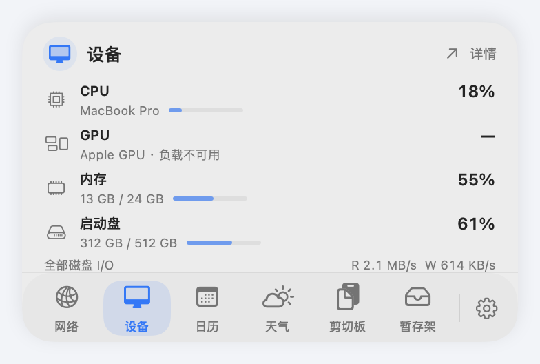

<p align="center">
  
</p>

<h1 align="center">NetStats</h1>

<p align="center">Mac 菜单栏里的系统监控与日常工具</p>

<p align="center">
  <strong>简体中文</strong> · <a href="README.en.md">English</a>
</p>

<p align="center">
  <a href="https://github.com/autumncry/netstats/releases/latest"></a>
  
  <a href="LICENSE"></a>
</p>

<p align="center">
  <a href="https://github.com/autumncry/netstats/releases/download/v2.01/NetStats-2.0.1.dmg"><strong>下载 v2.01</strong></a> ·
  <a href="https://github.com/autumncry/netstats/releases/tag/v2.01">更新说明</a> ·
  <a href="https://autumncry.github.io/netstats/">项目网站</a>
</p>

<p align="center">
  
  
  <br>
  <sub>v2.01 原生界面渲染 · 示例数据 · 开启“减少透明度”。<a href="assets/screenshots/v2.01/README.md">图片说明</a></sub>
</p>

查看网速和设备状态，翻看日程与天气，找回刚刚复制的内容，或暂存待用文件。点击菜单栏即可打开；在有实体刘海的 MacBook 上，也可以通过悬停唤出同一张卡片。

## 安装

**[下载 NetStats-2.0.1.dmg](https://github.com/autumncry/netstats/releases/download/v2.01/NetStats-2.0.1.dmg)** · macOS 14+ · Apple Silicon / Intel

升级前请先退出旧版 NetStats；替换应用会保留原有设置和本机历史。

1. 打开 DMG，将 **NetStats.app** 拖入 **Applications（应用程序）**。
2. 从应用程序打开 NetStats，点击菜单栏图标开始使用。

> 安装包采用临时签名，尚未经过 Apple 公证。若首次打开被拦截，请确认来自本仓库后，在 **系统设置 → 隐私与安全性** 中允许打开。[校验文件](https://github.com/autumncry/netstats/releases/download/v2.01/NetStats-2.0.1.dmg.sha256)

## 一张卡片，六种用途

### 看清 Mac 的状态

- **网络** — 实时下载与上传速度、双色趋势、启动后的累计流量。
- **设备** — CPU、GPU、内存与存储概览；需要更多信息时，打开“详情”查看完整监控。

### 日程与天气，随手查看

- **日历** — 按月或按周浏览，查看选中日期的日程；创建与编辑交给系统日历。
- **天气** — 通过系统快捷指令连接 Apple 天气，显示指定城市的当前气温和天气状况。[配置指南](docs/weather-shortcut.md)

### 复制过的内容，用得到的文件

- **剪切板** — 保存文字与图片历史，支持搜索、预览、再次复制、暂停和清空。
- **暂存架** — 拖入文件或文件夹，随后拖到其他应用使用；仅保存引用，不移动或删除原文件。

## 按你的习惯使用

点击卡片底部的功能栏切换内容，点击齿轮打开**独立设置窗口**。各项功能都能单独开关，菜单栏与刘海入口共用设置。

- **菜单栏**：点击展开，再次点击收起，无需刘海屏。
- **刘海悬停**：在设置中开启后，停留 1 秒展开，移出后自动收起。
- **完整监控**：点击“详情”，进入 Native / Terminal 面板，查看更多系统指标、进程排行和 Clash Verge Dev 状态。

网络、设备和暂存架默认启用；日历、天气、剪切板及刘海悬停需在设置中开启。支持简体中文、英文和系统深浅色外观。[使用说明](docs/notch-hover.md)

## 常见问题

<details>
<summary><strong>天气为什么没有显示？</strong></summary>

先启用天气，再创建名为 `NetStats Weather` 的系统快捷指令，并在 NetStats 中测试连接。安装应用不会自动创建快捷指令；可以按[带截图的配置指南](docs/weather-shortcut.md)操作。卡片显示当前天气状况，不提供天气预报。

</details>

<details>
<summary><strong>GPU 负载为什么显示“—”？</strong></summary>

部分设备或驱动没有提供有效读数。NetStats 会标为不可用，而不是显示成 0%。

</details>

<details>
<summary><strong>可以用 Homebrew 或 npm 安装吗？</strong></summary>

目前请使用上方 DMG。独立 Homebrew tap 尚未同步 v2.01，npm 包尚未发布。

</details>

## 隐私与权限

无需账号，不包含遥测。系统指标、剪切板历史和文件引用在本机处理。剪切板历史没有额外的应用层加密，可随时暂停或清空。

日历需主动授权；剪切板在支持访问控制的 macOS 上需允许后台读取。天气快捷指令可能连接 Apple 服务。可选的公网 IP 查询使用 `ipinfo.io`，可在设置中关闭。NetStats 只展示 Clash Verge Dev 状态，不控制或重启它。[隐私说明](docs/PRIVACY.md) · [权限说明](docs/PERMISSIONS.md)

## 从源码构建

需要 Swift 6 和 macOS 26 SDK 或更新的工具链。

```bash
git clone https://github.com/autumncry/netstats.git
cd netstats
NETSTATS_BUILD_CONFIGURATION=release ./script/build_and_run.sh
```

运行测试：`swift test` 与 `swift run NetStatsLogicTests`。更多构建与打包方式见[开发指南](CONTRIBUTING.md)。

## 反馈与贡献

欢迎[报告问题或提出建议](https://github.com/autumncry/netstats/issues)。提交问题时，请附上应用版本、macOS 版本、Mac 型号与复现步骤；界面问题可以附上已隐藏私人信息的截图。

[贡献指南](CONTRIBUTING.md) · [更新记录](CHANGELOG.md) · [安全问题](SECURITY.md)

## 开源协议

[MIT](LICENSE)
