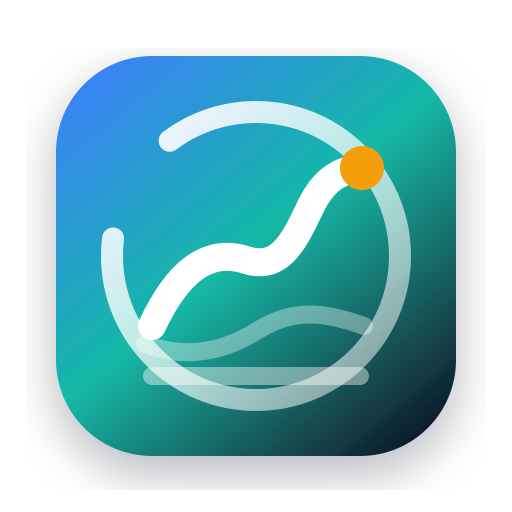
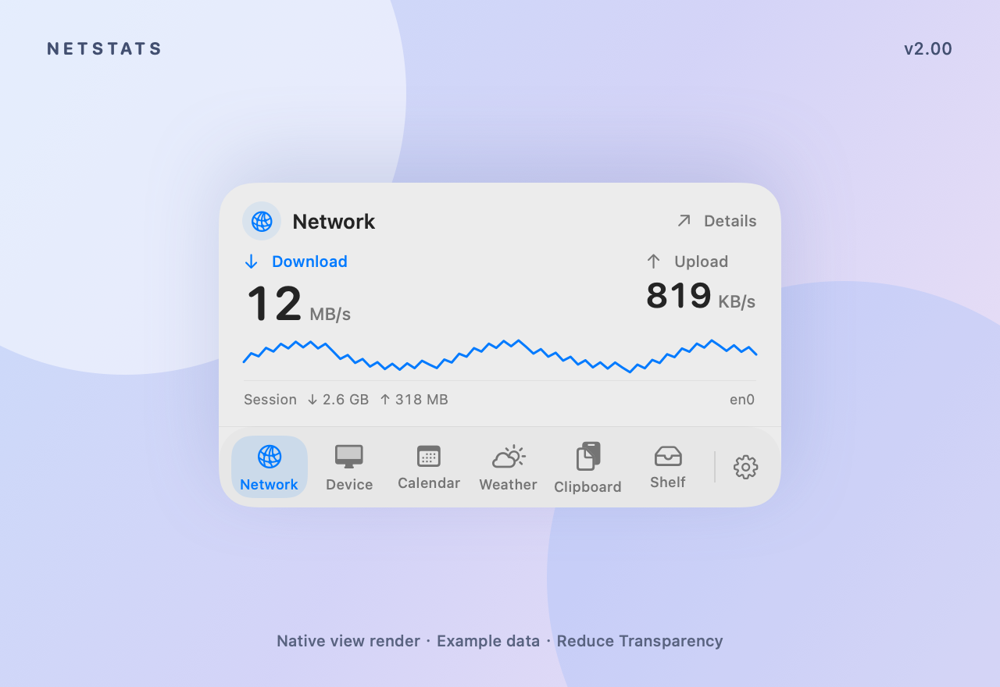
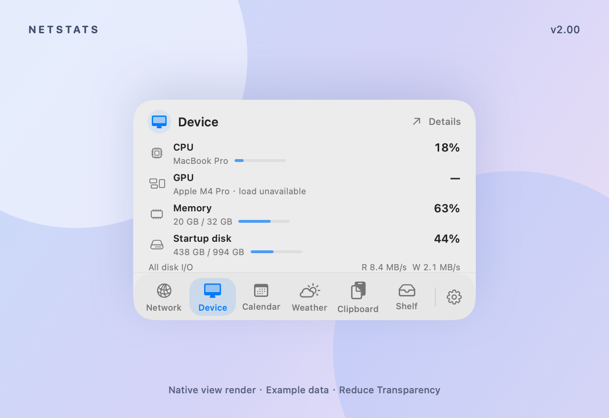

<p align="center">
  
</p>

<h1 align="center">NetStats v2.00</h1>

<p align="center">
  <strong>一张 360 pt 原生玻璃卡片，切换网络、设备、日历、天气、剪切板和暂存架。菜单栏点击与实体刘海悬停共用功能和设置。</strong>
</p>

<p align="center">
  中文 | <a href="README.en.md">English</a>
</p>

<p align="center">
  <a href="https://github.com/autumncry/netstats/releases/download/v2.00/NetStats-2.0.0.dmg">下载 v2.00 通用 DMG</a> ·
  <a href="https://github.com/autumncry/netstats/releases/tag/v2.00">版本说明</a> ·
  <a href="https://autumncry.github.io/netstats/">查看功能与界面</a>
</p>

<p align="center">
  <a href="https://github.com/autumncry/netstats/actions/workflows/ci.yml"></a>
  <a href="https://autumncry.github.io/netstats/"></a>
  <a href="https://github.com/autumncry/netstats/releases"></a>
  
  
  <a href="LICENSE"></a>
  <a href="https://github.com/autumncry/netstats/issues"></a>
  <a href="https://github.com/autumncry/netstats/stargazers"></a>
</p>

<p align="center">
  
  
</p>

<p align="center">
  v2.00 原生 SwiftUI 组件渲染：英文界面、全部功能启用、示例数据，并开启“减少透明度”。不是实时桌面截图；实际玻璃材质随 macOS、外观、桌面背景及辅助功能设置变化。
</p>

## 目录

- [安装](#安装)
- [系统要求](#系统要求)
- [特性](#特性)
- [隐私](#隐私)
- [常见问题](#常见问题)
- [从源码构建](#从源码构建)
- [项目资料](#项目资料)
- [贡献](#贡献)
- [开源协议](#开源协议)

## 安装

### v2.00 DMG（推荐）

下载 [NetStats-2.0.0.dmg](https://github.com/autumncry/netstats/releases/download/v2.00/NetStats-2.0.0.dmg)，打开后将 `NetStats.app` 拖到 `/Applications`。同一个通用安装包包含 Apple Silicon（arm64）和 Intel（x86_64）版本。

[GitHub Release](https://github.com/autumncry/netstats/releases/tag/v2.00) · [SHA-256 校验文件](https://github.com/autumncry/netstats/releases/download/v2.00/NetStats-2.0.0.dmg.sha256)

v2.00 使用临时签名（ad-hoc），未使用 Developer ID 签名，也未经过 Apple 公证。macOS 首次打开可能拦截；确认下载来源后，可在 **系统设置 > 隐私与安全性** 中允许打开，具体步骤见发布页。

### Homebrew 与 npm

[Homebrew tap](https://github.com/autumncry/homebrew-tap) 尚未同步 v2.00，`@autumncry/netstats` npm 包尚未发布。安装本版本请使用上方 DMG，或从源码构建。

## 系统要求

- macOS 14.0 或更高版本；通用 DMG 支持 Apple Silicon 和 Intel Mac
- 菜单栏入口适用于支持的 Mac；可选刘海入口需要内置实体刘海屏，默认关闭
- macOS 26+ 使用系统玻璃效果；macOS 14/15 使用原生模糊材质，并响应系统外观、减少透明度和减少动态效果设置
- 日历、天气、剪切板需在设置中主动启用并完成各自授权或配置
- Clash Verge Dev 状态展示需要本机已安装并运行 Clash Verge Dev

## 特性

### 六功能 Dock

| 功能 | 内容 |
| --- | --- |
| 网络 | 实时上下行速率、短历史趋势、会话流量与活动接口。 |
| 设备 | CPU、GPU 型号及可用负载、已用/总内存、启动盘容量；磁盘读写为全部块设备合计，不可用 GPU 读数显示“—”。 |
| 日历 | 月/周浏览、选中日期日程、选择日历；显式授予系统完整访问后查询，创建和编辑交给系统 Calendar。 |
| 天气 | 通过你配置并测试成功的系统快捷指令读取 Apple 当前天气；15 分钟缓存、手动刷新、失败保留上次结果。见[设置说明](docs/weather-shortcut.md)。 |
| 剪切板 | 本机文字和图片历史、搜索、分页、预览、复制、暂停、清空和排除应用；默认保留 30 天、数量不限，文字/图片可分别设上限，保存期限可设 1–30 天。 |
| 暂存架 | 文件与文件夹引用持久保存，支持拖入/拖出、打开、移除和重新关联；不移动原件，移除引用不会删除文件。 |

### 两个入口，同一张卡片

点击菜单栏状态项即可打开卡片，再次点击关闭。在设置中开启刘海入口后，连续悬停 1 秒展开，移出刘海和卡片 300 毫秒后收起。有效文件拖到刘海停留 500 毫秒进入暂存架，松手才添加引用。

底部 Dock 点击切换功能，齿轮进入共享设置；网络、设备、暂存架初始启用，日历、天气、剪切板初始关闭。被动浏览与 Dock 点击不抢焦点，主动输入、弹窗和拖放期间保持展开。详见[玻璃功能卡片](docs/notch-hover.md)。

### 完整监控继续保留

点击卡片「详情」打开 Native / Terminal 完整面板，查看系统负载、内存明细、磁盘、电源、短历史、进程排行、公网 IPv4、地理位置和 Clash Verge Dev 状态。无法通过稳定公开 API 获取的进程分类会说明原因。

Clash 信息包含运行状态、系统代理、TUN、模式、订阅流量、代理组和当前节点。NetStats 只展示状态，不退出、重启或控制 Clash Verge Dev。菜单栏指标、悬停提示、详细面板模块、公网 IP 查询均可配置，支持中文和英文。

## 隐私

系统指标、网络速度、进程排行与 Clash Verge Dev 状态均在本机读取和处理，不上传到 NetStats 项目服务器，不需要账号，也不包含遥测。

- **日历**：系统 Full Access 包含读写能力；NetStats 仅查询日程，首次授权由设置中的按钮发起。
- **剪切板**：历史只保存在本机 SQLite 与图片文件中，没有额外应用层加密。支持暂停、清空、排除应用和保留期限；关闭收集不立即删除历史，仍按期限清理。新版 macOS 允许后台读取后才自动记录，悬停不请求权限。
- **暂存架**：只保存本机文件书签引用；原文件移动或磁盘离线时可能需要重新关联。
- **天气**：由你指定的系统快捷指令返回当前天气，首次测试成功前不后台运行；快捷指令可能使用 Apple 的网络和定位服务，不读取 Weather.app 私有缓存。
- **公网 IP**：可选请求 `ipinfo.io` 解析公网出口与位置，可直接在设置中关闭。

卡片不新增辅助功能、输入监控或录屏权限。更多细节见 [Privacy](docs/PRIVACY.md) 和 [Permissions](docs/PERMISSIONS.md)。

## 常见问题

### 没有刘海屏可以使用吗？

可以。菜单栏点击入口提供相同的六功能卡片，只有可选的刘海悬停入口需要内置实体刘海屏。

### 为什么 macOS 提示无法验证开发者？

v2.00 DMG 使用临时签名，尚未经过 Developer ID 签名和 Apple 公证。请从[官方发布页](https://github.com/autumncry/netstats/releases/tag/v2.00)下载、核对校验文件，并按发布页说明允许首次打开；也可从源码构建。

### 天气为什么没有自动显示？

天气默认关闭，需要配置专用的系统快捷指令，再在 NetStats 设置中测试连接。它展示当前天气，不提供天气预报。见[天气设置说明](docs/weather-shortcut.md)。

### GPU 为什么显示“—”？

GPU 型号可显示，但负载读数依赖驱动提供的数据。没有有效读数时显示不可用，不用 0% 代替。

### Clash Verge Dev 信息从哪里读取？

NetStats 读取同一台 Mac 上的配置、进程、系统代理与本地 Mihomo 控制接口，不把这些信息上传到项目服务器，也不会控制或重启 Clash Verge Dev。

### Homebrew 或 npm 能安装 v2.00 吗？

目前请使用本页的 v2.00 DMG。独立 Homebrew tap 尚未同步该版本，npm 包尚未发布。

## 从源码构建

需要 Swift 6，以及包含 macOS 26 SDK 或更高版本的工具链。macOS 14 是应用的运行系统下限，不是旧版 SDK 的构建兼容承诺。

```bash
git clone https://github.com/autumncry/netstats.git
cd netstats
swift build -c release
```

打包菜单栏 App：

```bash
scripts/package_app.sh
open build/NetStats.app
```

生成 DMG：

```bash
scripts/package_dmg.sh
open dist
```

## 项目资料

- [Website](https://autumncry.github.io/netstats/)：六功能介绍、界面与下载
- [Release Notes](docs/release-notes/v2.00.md)：v2.00 版本说明
- [Glass Hub](docs/notch-hover.md)：双入口、交互与保存方式
- [Weather Setup](docs/weather-shortcut.md)：Apple 天气快捷指令配置
- [Roadmap](docs/roadmap.md)：后续功能、分发方式和设计原则
- [Changelog](CHANGELOG.md)：版本更新记录
- [Release Checklist](docs/release-checklist.md)：后续版本发布检查清单
- [Privacy](docs/PRIVACY.md)：数据读取、外部请求和本地优先边界
- [Permissions](docs/PERMISSIONS.md)：当前权限模型和受限指标说明
- [Product Growth](docs/product-growth.md)：产品力改进和 SEO 增长计划
- [Contributing](CONTRIBUTING.md)：开发环境、PR 要求和隐私注意事项
- [Security](SECURITY.md)：安全与隐私问题报告方式
- [Launch Kit](docs/launch-kit.md)：项目介绍和传播文案

## 贡献

Issue 和 Pull Request 都欢迎。适合贡献的方向包括：原生卡片交互、功能适配、Developer ID 签名与公证、Homebrew tap 维护和更多代理客户端状态适配。

如果愿意分享项目，可以参考 [Launch Kit](docs/launch-kit.md)。如果 NetStats 对你有帮助，欢迎点一个 Star。

## 开源协议

MIT License，详见 [LICENSE](LICENSE)。
