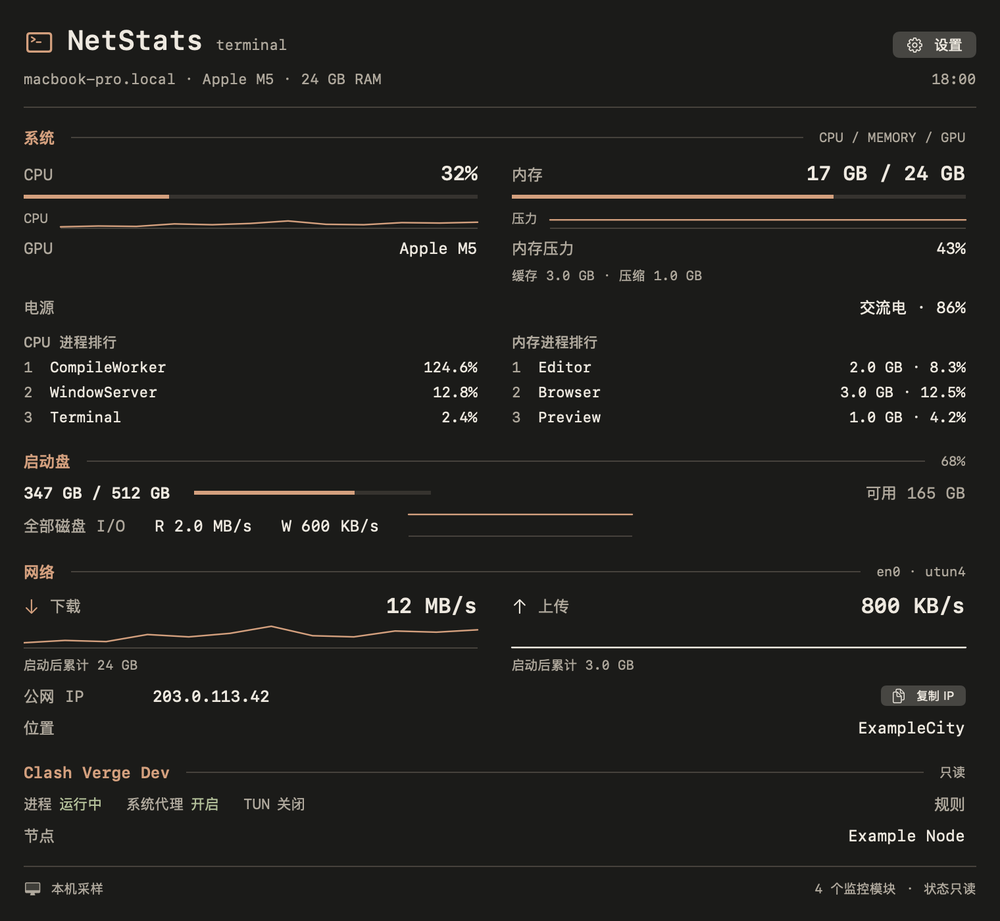

# NetStats v2.02 — 待发布 / Unreleased

应用版本 **2.0.2** · 构建 **29** · macOS **14+**

此页面用于审核 v2.02 的源码改动，不代表 GitHub Release 或 DMG 已发布。当前正式下载仍为 v2.01。

## 本次更新

- **双指切页**：卡片内水平滑动切换已启用功能，一次一页、到边缘停止；保留纵向滚动，输入、弹窗和拖放时避免误切。
- **切页动画**：约240毫秒的方向滑动与淡入淡出，窗口高度同步衔接；减少动态效果时使用短淡入淡出。快速反向、立即调整尺寸和关闭重开不会保留旧动画目标。
- **屏顶适配**：自动识别可用的内置实体刘海，没有刘海屏时使用主屏顶栏；也可手动选择刘海或顶栏。顶栏支持悬停、点击展开和既有文件暂存流程。
- **设置**：新增系统登录项开关和关于页，包含版本、构建号、版权、MIT协议、项目地址及 Star 支持入口。升级不会自动替用户开启登录自启。
- **设备卡片**：补足内容高度，完整显示启动盘明细与全部磁盘I/O。
- **Terminal详情**：深炭灰与暖橙、等宽列、平面分节、固定头尾及滚动正文。移除没有依据的 Health 评分和网络伪利用率，统一遵守模块、历史和进程排行开关；保留设置和IP复制。

## Terminal 预览

以下由本版本原生 SwiftUI/AppKit 组件渲染，使用合成数据；不是实时桌面截图。说明与校验见[图片来源](../../assets/screenshots/v2.02/README.md)。

[English preview](../../assets/screenshots/v2.02/terminal-en.png)

## 验证范围

- 自动测试覆盖手势分类、方向、快速反向窗口动画、布局空间、设置持久化、登录项状态流、显示适配和 Terminal 的实际渲染内容。
- 本机已经检查顶栏点击、自动刘海识别、关于页；真实触控板切页与动画已获使用反馈。
- 登录自启经主动开启后确认系统登记为 enabled/allowed，应用重启后仍开启；未执行注销或系统重启验证。
- 无刘海回退有几何回归和手动顶栏检查；无刘海实体Mac、合盖、多显示器、全屏及睡眠唤醒仍需继续真机覆盖。

## English

This pending release adds animated two-finger page navigation, automatic notch/top-bar selection, system-backed launch at login and an About page. It fixes clipped device information and replaces Terminal details with a compact charcoal-and-warm-orange interface. Existing preferences and local data remain in place; login startup is enabled only by an explicit user action.

Terminal previews use synthetic data rendered by the native components. A release asset is not published by this pull request. See the [card guide](../notch-hover.md) and [Terminal design notes](../terminal-style.md).
