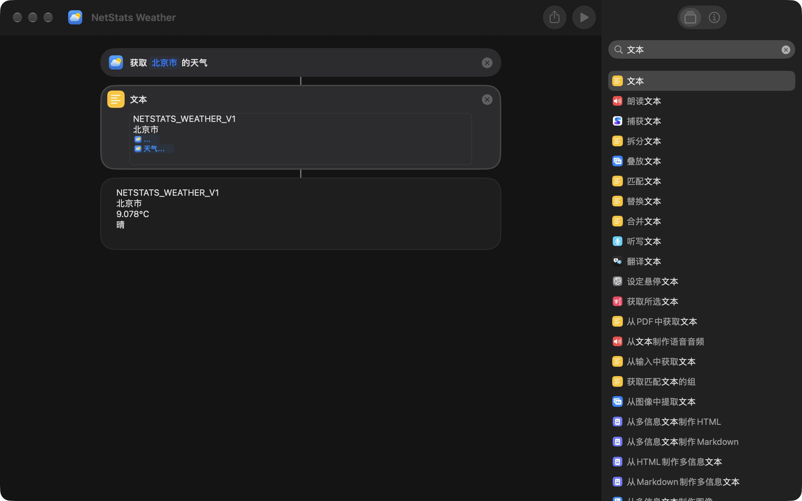
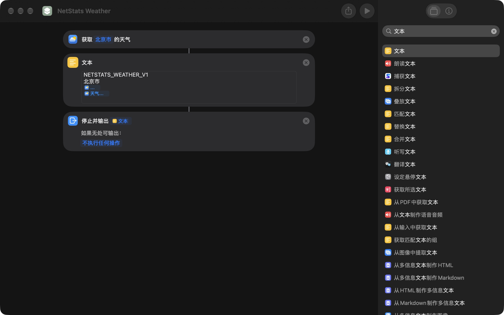

# 天气设置：从零配置北京市

这份说明适用于 v2.01 及以后版本。新版支持四行文本，不再要求手写 JSON、字典或日期格式；原有 JSON 快捷指令仍可使用。

如果你当前已经有 **NetStats Weather**，可以直接从第 6 步检查连接，不必重复创建。本机已于 2026-11-09 完成实际联调，NetStats 显示“已连接：北京市”。

**先分清两个地方：**系统「快捷指令」负责取得天气；NetStats 只填写它的名称并读取结果。在 NetStats 输入 `NetStats Weather` 不会自动创建快捷指令。

## 1. 创建并命名

1. 打开 macOS 自带的「快捷指令」App，点击右上角 **＋**。
2. 将窗口顶部名称改为 **NetStats Weather**，按回车。
3. 在右侧搜索 **获取当前天气**，双击添加。

如果已有一个仅包含天气动作、名为「获取当前天气」的快捷指令，可以直接将它改名，不必再创建一个。

## 2. 正确选中北京市

1. 点击天气操作里的蓝色 **当前位置**。
2. 选中原文字并输入 **北京**。
3. 等下方出现地点建议，**点选带地点图标的「北京市」搜索结果**。
4. 确认整个操作显示 **获取 北京市 的天气**。

只输入城市名称后按回车或离开字段，可能没有选中真正的地点，运行时会退回「当前位置」。本次实际操作中遇到了这个问题，并出现“无法找到你的当前位置”；从搜索结果选中北京市后，天气动作成功返回了北京市天气。固定城市不需要读取设备的精确位置。

此时可以先点右上角 **▶**。如果能看到北京市的气温和天气描述，再继续下一步。若仍报定位错误，先回头检查蓝色地点是否真的为「北京市」。

## 3. 只增加一个「文本」操作

在右侧搜索 **文本**，双击最上面的「文本」，放在天气操作下方。先完成下面两个操作，检查输出后再增加最后的“停止并输出”：

```text
获取 北京市 的天气
        ↓
文本
```

在文本框中安排四行：

```text
NETSTATS_WEATHER_V1
北京市
【气温变量】
【天气状况变量】
```

第 1 行是固定标记，第 2 行是卡片显示的城市名称。更换城市时，要同时修改天气操作的地点和文本第 2 行，避免把其他城市的天气标成北京市。**第 3、4 行的括号文字只是位置提示，必须删掉并换成蓝色变量；不要自己填写温度和天气。**

### 第 3 行：气温

1. 将光标放在第 3 行。
2. 右键 → **插入变量 → 天气状况**，插入上一步天气动作的输出。
3. 点击刚插入的蓝色变量。在弹出面板的 **获取** 列表中选择 **气温**。
4. 出现 **单位** 选项后，选择 **摄氏度**。
5. 点击文本框外的空白处收起面板，保留这个蓝色变量。

注意：插入变量时默认选中的是整个天气结果，它可能输出“9°C，晴”。必须选择“气温”属性，才能只输出“9°C”。

### 第 4 行：天气状况

1. 在气温变量之后换行，将光标放在第 4 行。
2. 再次右键 → **插入变量 → 天气状况**。
3. 点击新的蓝色变量，在 **获取** 列表中选择位于 **体感温度下方**的 **天气状况**，然后点击空白处收起面板。

列表最上方也有一个「天气状况」，代表整个天气对象；这里需要的是下方的具体属性。如果点选后没有变化，可先按 Tab 将焦点移入列表，再用方向键选择，确认目标行被选中。

## 4. 先在快捷指令里运行

点击右上角 **▶**。正确结果应恰好为四行，例如：

```text
NETSTATS_WEATHER_V1
北京市
9°C
晴
```

这里的 `9°C`、`晴` 只用于说明结果形状，实际数值应由蓝色变量生成并随天气变化。

- 第 3 行必须只有带单位的气温，不能是“9°C，晴”。
- 第 4 行必须是天气描述，不要保留括号占位文字。
- 检查结果时先以“文本”作为末尾，方便在快捷指令窗口直接看到四行内容。
- 无需另加日期动作，NetStats 会记录取得结果的时间。

下面是本次实际操作得到的快捷指令结果（北京市，2026-11-09）。蓝色变量输出的是实时结果：



## 5. 明确返回文本给 NetStats

在右侧搜索 **停止并输出**，双击添加到最后，结果选择前一步的蓝色 **文本** 变量。“如果无处可输出”保持“不执行任何操作”即可。

完整流程应为：

```text
获取 北京市 的天气
        ↓
文本（四行，使用蓝色气温和天气状况变量）
        ↓
停止并输出 文本
```



该步骤用于明确将结果交给调用它的 NetStats。不要把蓝色结果设为“快捷指令输入”或整个“天气状况”。

## 6. 返回 NetStats 测试

1. 打开 **NetStats 设置 → 天气**，开启 **在功能卡片中启用**。
2. 名称填写 **NetStats Weather**，必须与快捷指令顶部名称完全一致。
3. 点击 **测试连接**。
4. 看到绿色“已连接：北京市 · 气温 · 天气状况”后，回到卡片点击 **天气**。

只有首次测试成功后才允许后台刷新。自动刷新使用 15 分钟缓存；卡片上的手动刷新会绕过缓存。失败时保留上次成功结果并提示时间。

## 常见卡点

| 提示或现象 | 检查方式 |
|---|---|
| 系统里找不到这个名称 | 先在「快捷指令」App 创建流程；核对名称中的空格和字母。 |
| 无法找到当前位置 | 没有真正选中城市。输入北京后必须选择下方「北京市」地点结果。 |
| 快捷指令运行了但没有输出 | 最后添加「停止并输出」，结果选择前一步「文本」。 |
| 返回格式不正确 | 检查四行；第 3 行是气温变量并带 °C/℃，第 4 行是天气状况属性。 |
| 等待 20 秒后停止 | 先在系统快捷指令中运行，检查网络或未处理的弹窗，再回来重试。 |
| 卡片仍显示旧数据 | 检查是否测试成功，或点击手动刷新；失败时旧结果会保留并标记。 |

## 兼容与技术说明

新版接受上面的四行 UTF-8 文本，支持摄氏/华氏单位并换算为摄氏度。纯数字温度不会被猜测成摄氏度。原有包含 `location`、数值型 `temperatureC`、`condition`、ISO 8601 `updatedAt` 的 JSON 仍兼容。

本次真机联调还发现：macOS 27 下强制 `--output-type public.utf8-plain-text` 可能成功退出却不生成文件。修正版已改为默认类型和 `.txt` 目标路径，实际命令行输出已验证正常。

NetStats 通过公开的 `/usr/bin/shortcuts run` 调用你指定的快捷指令；首次测试会先检查该名称是否存在。名称检查与天气执行共用 20 秒预算，不会因悬停卡片反复启动流程。当前版本展示当前天气，不推断天气预报，也不读取 Weather.app 私有缓存。

Apple 官方说明：[从命令行运行快捷指令](https://support.apple.com/guide/shortcuts-mac/apd455c82f02/mac) · [快捷指令变量](https://support.apple.com/guide/shortcuts-mac/apdd2b316022/mac)
